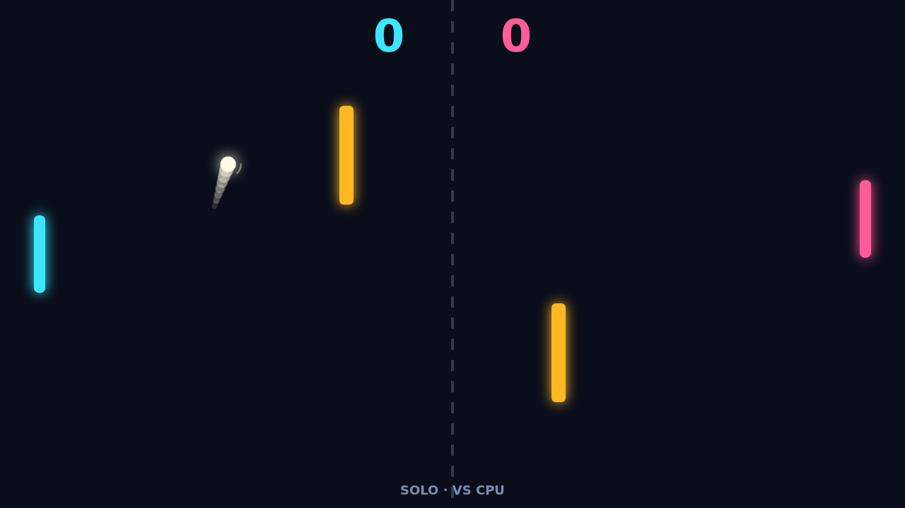

# Carom

Carom is a paddle duel played across a dark, glowing field. A ball ricochets
between your paddle and your opponent's, and a pair of amber bars stand in the
middle of the court to get in the way. Play Solo against the CPU or Versus with a
friend on the same keyboard, and race to eleven points, two clear of your rival.

A match opens with a short breath: the ball waits at the center while you set
your paddle, then drifts out toward the player who just lost the last point. The
first rallies are slow and readable. Every paddle hit nudges the ball faster, so
by the time the score creeps toward match point the ball is a blur and a tight
angle off the edge of your paddle is all you need or can manage.

Spin is what makes Carom Carom. If your paddle is moving when it strikes the ball,
that motion is handed to the ball and its flight bends afterward, curling down if
you were sweeping down and up if you were sweeping up. The bend fades within about
a second, so you decide how much of it to spend before the ball reaches the far
side.

The obstacles turn that bend into a puzzle. A shot that looks wide can curl around
a bar, and a straight drive can be banked off one to arrive where nobody is
standing. At ten all there is no sudden death, only the two-point lead, and the
best rallies are the ones where you aim for the bars on purpose.
